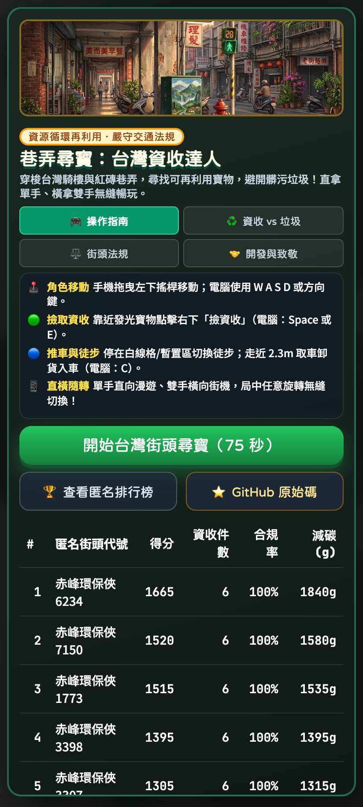
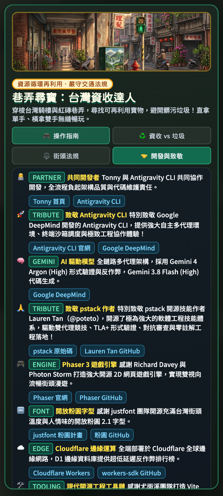
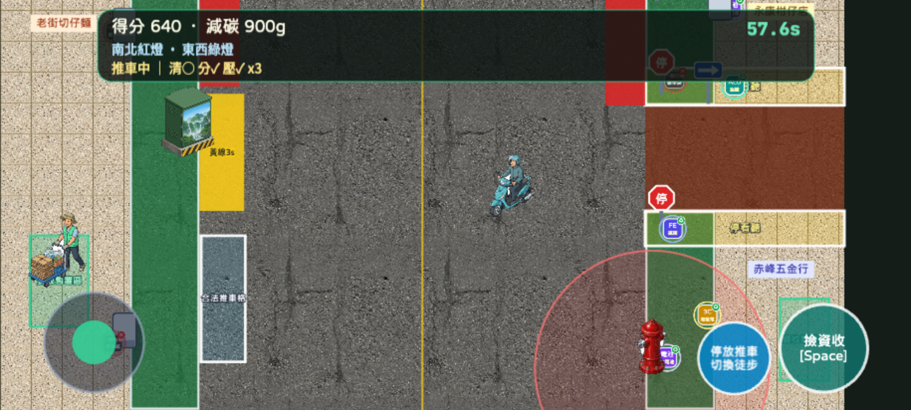
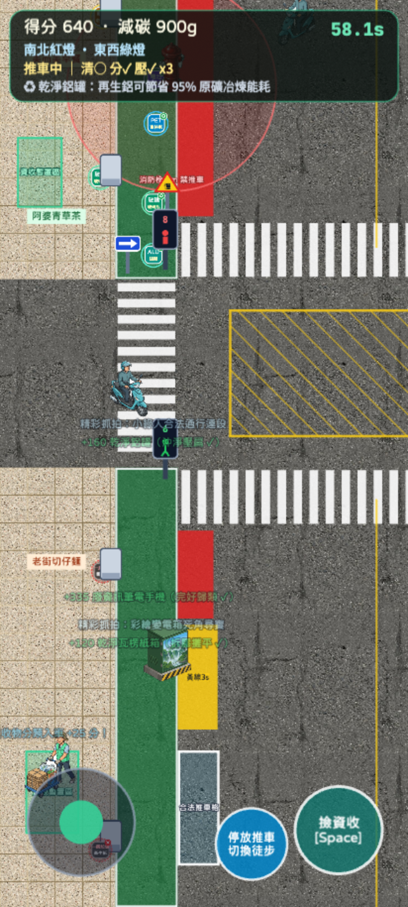
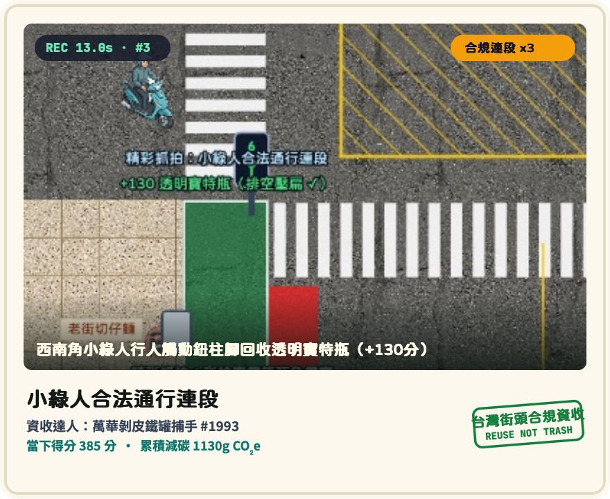
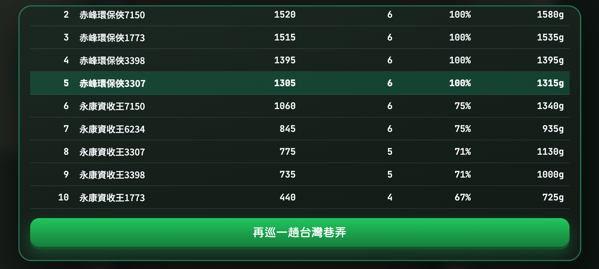

# 巷弄尋寶：台灣資收達人 (Taiwan Recycle Hunter)

<div align="center">

[](https://pstack.tonny.tw)
[](https://github.com/tonnychiulab/taiwan-recycle-hunter)
[](https://github.com/cursor/plugins/tree/main/pstack)
[](https://deepmind.google)
[](https://antigravity.google/product/antigravity-cli/)
[](verification/legal_pickup.tla)
[](https://workers.cloudflare.com)
[](LICENSE)

### 🕹️ **[👉 點此立即線上暢玩：https://pstack.tonny.tw 👈](https://pstack.tonny.tw)**
**免安裝 · 手機直拿單手 / 橫拿雙手無縫隨機旋轉 · 台灣實景騎樓巷弄 · 全端邊緣雲運算**

</div>

---

## 🌟 專案概述 (Project Overview)

《巷弄尋寶：台灣資收達人》是一部以台灣常民街道文化為背景的 HTML5 動作網頁遊戲。玩家推著台灣街頭最地道的鐵製手推車，穿梭於騎樓磨石子廊道、紅磚巷弄、小吃招牌、機車停放格與彩繪變電箱之間。

**遊戲核心精神在於傳遞「資源循環再利用」理念，嚴格區分「可再利用資源回收物」與不可再生的「一般髒污垃圾」**，並將台灣真實道路交通法規（行人穿越道、小綠人三態號誌、消防栓 5 公尺淨空禁推車、無號誌巷口「停」標誌靜止確認）化為核心機制，在守法合規的節奏中完成街頭尋寶。

---

## 🧠 核心工程體系：pstack × Google Gemini 多代理嚴謹架構

本專案由 **Tonny** 與 Google DeepMind **Antigravity CLI** 共同協作，**全程嚴格遵循 Lauren Tan 開源的 `pstack` 軟體工程多代理體系（poteto-mode）**，拒絕任何粗糙生成與浮誇代碼，以極致的軟體工程準則落實全鏈路開發：

### 1. 雙代理架構競技場 (Architect Arena)
- 在設計初期同時派出兩位候選代理：Candidate 1 專注於衍生統計與延遲高光抽樣，Candidate 2 專注於正交狀態機降維。
- 主架構裁判綜合兩者優勢：選用正交法規鎖存狀態機對齊形式化驗證，並融合 7 類資收物結構化統計，在型別系統層面結構性杜絕「垃圾誤計為資收」的邏輯缺陷。

### 2. TLA+ 數學形式化驗證 (Mathematical Formal Verification)
- 撰寫精確的 TLA+ 形式化規格檔案 [`verification/legal_pickup.tla`](verification/legal_pickup.tla)。
- 搭配輕量 BFS 狀態空間窮舉引擎 [`scripts/verify-formal.ts`](scripts/verify-formal.ts)，以 166 毫秒窮舉遍歷 **13,752 個抽象狀態** 與 **586 個具體執行狀態**。
- 嚴格證明 5 大法規安全不變量（Safety Invariants），並在紅綠突變測試中 100% 成功捕獲 4/4 注入的違規狀態突變。

### 3. 紅隊對抗性審查與 TDD 補強 (Adversarial Interrogation)
- 派出獨立的對抗性代理人（Adversarial Interrogator）深入代碼庫挖掘邊界漏洞，成功回報 5 項實務漏洞：
  1. 開局偽造座標撿拾（無地圖種子核驗）。
  2. 已結算 Session 無限更新街頭代號造成 DoS。
  3. 160ms 雙擊撿拾引發重送競態。
  4. 徒步暫置取車時的位置漂移。
  5. Phaser 遊戲焦點全域攔截鍵盤，導致排行榜輸入框無法打字。
- 全流程透過 Red-Green TDD（先寫失敗測試、再寫最小修復）徹底修復，回歸測試 22 項全部綠燈。

### 4. 零註解代碼衛生審查 (0-Comment Hygiene)
- 由專屬審查代理人 `comment-sicko` 全域掃描，全專案 25 個生產代碼檔案全面剔除多餘註解與死代碼。
- 藉由清晰的命名、嚴謹的 Zod 契約定義與純函式管線達成自我文檔化（Self-documenting Code）。

### 5. 決策軌跡與 Token 耗用帳本 (Decision Trail & Token Ledger)
- 每一項架構取捨與環境決策皆精確紀錄於 [`.audit/decisions.tsv`](.audit/decisions.tsv)。
- 建立專屬 Token 統計工具 [`scripts/report-token-usage.mjs`](scripts/report-token-usage.mjs)，完整審計 9 個多代理對話、331 次推理互動、累計消耗逾 4,146 萬 Token（包含 3,864 萬快取命中），確保 AI 協同工程全程具備最高透明度。

---

## 🤖 AI 驅動模型分工 (Model Division of Labor)

| 模型名稱 | 推理配置 | 擔綱角色與核心任務 |
| :--- | :---: | :--- |
| **Gemini 4 Argon** | High Reasoning Budget | **主架構決策與形式驗證**：負責雙代理架構競技、TLA+ 狀態機規格推演、Cloudflare 邊緣反作弊種子還原算法、紅隊安全對抗審查。 |
| **Gemini 3.8 Flash** | High Reasoning Budget | **高效構建與測試落地**：負責 Phaser 3 渲染場景管線、Web Audio 合成音效、Playwright 跨引擎 E2E 腳本編寫、美術圖素批次去背處理。 |
| **Antigravity CLI (`agy`)** | Native Tool Harness | **代理人自主運行環境**：提供本機終端安全沙箱、進程生命週期排程、反應式喚醒（Reactive Wakeup）與多代理併發協同。 |

---

## 📸 遊戲實機畫面展示 (Screenshots)

<div align="center">

### 🎮 首頁介面 · 操作指南與開源致敬
| 手機直向開始介面 · 2x2 雙列操作指南 | 🤝 共同開發者、AI 模型與全開源作者致敬 |
| :---: | :---: |
|  |  |

### 🕹️ 雙手機視向無縫漫遊 · 街頭資收與道規
| 雙手橫向街機：小綠人號誌與枕木紋行穿線 | 單手直向操作：騎樓磨石子與變電箱安全取物 |
| :---: | :---: |
|  |  |

### 📸 局終拍立得留念 · 街頭匿名排行榜
| 880x720 台灣街頭拍立得（精彩張力合成） | 零個資加鹽雜湊匿名排行榜 |
| :---: | :---: |
|  |  |

</div>

---

## 🎮 遊戲核心特色與玩法 (Game Features)

1. **直橫雙向局中無縫旋轉**：
   - 支援 iOS Safari (WebKit) 與 Android Chrome (Chromium)。
   - 自主研發 `DualOrientationViewport`，旋轉手機時即時動態重算搖桿中心、按鈕邊距與攝影機視野，局況不中斷、代幣不重置。
2. **可再利用資收物 vs. 一般髒污垃圾**：
   - **可再利用寶物（加分+減碳）**：透明寶特瓶、鋁罐、鐵罐、瓦楞紙箱、三色玻璃瓶、廢乾電池、廢 3C。
   - **完美三連 Combo**：同時集滿「清洗、分類、壓縮」三種特質，額外觸發 +120 分獎勵。
   - **一般髒污垃圾（嚴禁撿拾）**：油膩便當盒、衛生紙、菸蒂、髒塑膠袋。誤撿立即倒扣 60 分且中斷連擊！
3. **台灣道路交通法規狀態機**：
   - **小綠人三態號誌**：綠燈走行穿線；秒數不足閃爍禁止進入；闖紅燈記違規點數。
   - **消防栓 5 公尺紅圈**：推車推入 5m 禁區直接被開單！玩家須將推車停妥白線格或黃線區（限逗留 3 秒），改採徒步快取。
   - **無號誌巷口「停」**：遇八角形「停」標誌先靜止 0.4 秒確認無來車方可通行。
   - **彩繪變電箱安全取物**：僅允許在人行道側安全取物，站立車道側會受阻並觸發安全警告。
4. **自動抓拍 880x720 拍立得留念卡**：
   - 75 秒結算自動篩選局內 Top-3 最高張力瞬間（包含完美三連、號誌壓線快步、大批紙箱裝車）。
   - 透過 Canvas 動態合成復古台味拍立得留念卡，支援長按存圖與手機原生分享。
5. **邊緣雲端零個資排行榜**：
   - 全端部署於 Cloudflare Workers，資料庫採用邊緣 SQLite（Cloudflare D1）。
   - 零個資保護：開局自動產生台味街頭匿名代號（如「赤峰環保俠 6234」），搭配加鹽 IP 雜湊防止惡意刷榜。

---

## 🤝 共同開發者與致敬名單 (Credits & Tribute)

- **共同開發者**：[Tonny](https://tonny.tw) × [Antigravity CLI](https://antigravity.google/product/antigravity-cli/)
- **AI 驅動模型**：Google DeepMind [Gemini 4 Argon (High)](https://deepmind.google) 形式驗證與反作弊 + [Gemini 3.8 Flash (High)](https://deepmind.google) 代碼生成
- **架構體系開源作者**：特別致敬 [Lauren Tan (@poteto)](https://github.com/poteto)，開源了引領業界的軟體工程多代理框架 [pstack](https://github.com/cursor/plugins/tree/main/pstack)
- **Phaser 3 遊戲引擎**：致敬 [Richard Davey / Photon Storm](https://phaser.io) 與 [Phaser 原始碼](https://github.com/phaserjs/phaser)
- **開放粉圓字型**：致敬 [justfont 團隊](https://github.com/justfont/open-huninn-font) 與 [粉圓計畫](https://justfont.com/hungirl/)
- **邊緣雲端架構**：致敬 [Cloudflare Workers & D1 團隊](https://github.com/cloudflare/workers-sdk)
- **現代開源工程工具鏈**：[Vite](https://vite.dev) / [Vitest](https://vitest.dev)（尤雨溪團隊）、[Playwright](https://playwright.dev)（微軟團隊）、[Zod](https://zod.dev)（Colin McDonnell）

---

## 📁 目錄結構

```
taiwan-recycle-hunter/
├── src/
│   ├── domain/               # 純函式領域核心（交通法規狀態機、資收物定義、街道拓撲）
│   ├── game/                 # Phaser 3 渲染場景、雙視向視窗計算、拍立得合成、UI 彈窗
│   └── shared/               # 前後端共享契約、Zod Schema、法規常數
├── worker/                   # Cloudflare Worker 全端 API、HMAC 種子防作弊、排行榜
├── migrations/               # Cloudflare D1 SQL 遷移檔案 (0001_leaderboard.sql)
├── verification/             # TLA+ 形式化規格 (legal_pickup.tla)
├── scripts/                  # 形式驗證測試、Playwright E2E、Token 帳本匯出工具
├── docs/screenshots/        # 實機展示截圖 (直向/橫向/拍立得/致敬分頁)
├── .audit/                   # pstack 決策日誌 (decisions.tsv) 與 Token 帳本
└── public/                   # 街景實境圖素與開放粉圓開源字型
```

---

## 🛠️ 本地開發與完整驗證指令

安裝依賴並套用本地 D1 資料庫遷移：

```bash
npm install
npm run db:migrate:local
```

執行靜態型別檢查、領域與 Worker 單元測試，以及 TLA+ 狀態空間形式化驗證：

```bash
npm run typecheck
npm test
npm run verify:formal
```

建置前端並啟動本地 Cloudflare Worker + D1 預覽伺服器（預設連接埠 `8788`）：

```bash
npm run preview:edge
```

執行跨引擎（Playwright WebKit + Chromium）直橫雙向端對端實機驗證：

```bash
npm run build
npm run db:migrate:local
npm run verify:e2e
```

匯出完整多代理模型與 Token 耗用帳本至 `.audit/token-usage.tsv`：

```bash
npm run report:tokens
```

---

## 🚀 部署至 Cloudflare Workers

1. 建立遠端 D1 資料庫：

```bash
npx wrangler d1 create taiwan-recycle-leaderboard
```

2. 套用遠端 D1 資料表遷移並寫入 HMAC 密鑰：

```bash
npm run db:migrate:remote
npx wrangler secret put SESSION_SECRET
```

3. 建置並發布至 Cloudflare Workers（綁定自訂網域 `pstack.tonny.tw`）：

```bash
npm run deploy
```
